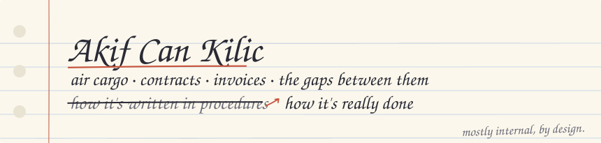
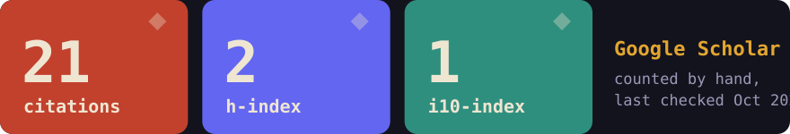

By day I'm a Sales & Marketing Specialist at Çelebi Cargo GmbH, working on
air cargo contracts, tariffs, and invoices. The interesting part is where those
don't match what actually happens on the ground.

On the side I run [Digital Yörük](https://digitalyoruk.com): AI education and
consulting in Turkish, a [YouTube channel](https://www.youtube.com/@digitaly%C3%B6r%C3%BCk),
and [Dijital Otağ](https://www.skool.com/digital-otag-3125/about), a community on Skool.

## How I got here

BSc [Industrial Engineering](https://endm.iku.edu.tr) (IKU),
MSc [Logistics & Financial Management](https://fbe.gsu.edu.tr/tr/lfy-ylisans) (Galatasaray).
Also completed part of an MSc in [Artificial Intelligence for Science and Technology](https://www.unimib.it/graduate/artificial-intelligence) (Milano-Bicocca),
and started a [PhD in Statistics](https://bilgipaketi.msgsu.edu.tr/programdetay/399/) at MSGSÜ, which I left.

At Invisible I worked on tool use and computer control, model evaluation,
red teaming, and multimodal tasks. At IKU I taught programming, OOP,
numerical analysis, probability, simulation, and engineering economics.

## Things I work with

- SGHA contracts, Annex B, tariff logic, revenue leakage
- n8n, Python, Node.js, Docker on a self-hosted VPS
- Language models for text-heavy and contract-like work

## Papers

- [*Prediction of University Students' Subjective Well-Being with Sleep and Physical Activity Data using Classification Algorithms*](https://openaccess.iku.edu.tr/entities/publication/2afe54fe-96b4-4a84-8bc7-1058a856ee3f), Procedia Computer Science, 2022
- [*Prediction of Mental Health: Heuristic Subjective Well-Being Model on Perceived Stress Scale Using Machine Learning Algorithms*](https://avesis.gsu.edu.tr/yayin/06b9585f-702b-46d8-9498-87f5b9f2c5b4/prediction-of-mental-health-heuristic-subjective-well-being-model-on-perceived-stress-scale-using-machine-learning-algorithms), International Journal of Machine Learning, 2023
- [*A Production Line Assignment Problem for a Textile Industry*](https://doi.org/10.21923/jesd.1101063), Mühendislik Bilimleri ve Tasarım Dergisi, 2023
